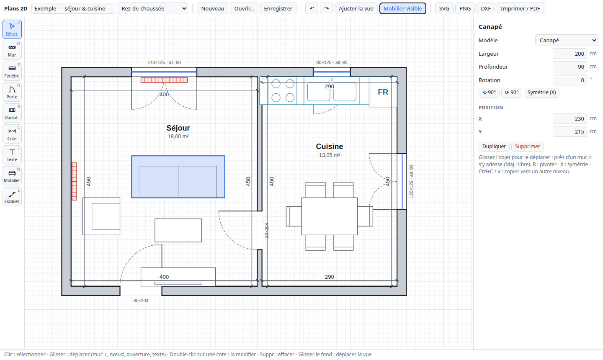

# Plans 2D

Éditeur de plans 2D (murs, portes, fenêtres, mobilier, escaliers, cotes, plusieurs niveaux) qui tourne entièrement dans le navigateur. Tout tient dans un seul fichier `index.html` : pas de dépendances, pas de serveur, pas d'étape de build.

**Démo en ligne : <https://loorisr.github.io/Plans2D/>**



## Démarrage

Utilisez la [version en ligne](https://loorisr.github.io/Plans2D/), ou ouvrez `index.html` dans un navigateur récent :

```bash
xdg-open index.html     # Linux
open index.html         # macOS
```

Vous pouvez aussi le servir en local avec `python3 -m http.server`.

## Fonctionnalités

- **Murs** : tracé point par point avec saisie de la longueur au clavier (`420`, ou `420<30` pour donner un angle), fermeture d'une pièce en recliquant le premier point. La ligne de tracé peut être la face intérieure, l'axe ou la face extérieure, et l'épaisseur se règle.
- **Isolation** : sur chaque face d'un mur (doublage intérieur ou isolation par l'extérieur), d'épaisseur libre, ajoutée à l'épaisseur du mur et dessinée en hachures. Un bouton l'applique à tout le contour d'une pièce ou à tout le contour extérieur. Elle est exportée sur un calque `ISOLATION` dans le DXF.
- **Ouvertures** : fenêtres (largeur, hauteur, allège), portes battantes (sens d'ouverture, charnière) ou coulissantes (en applique ou à galandage) et radiateurs, placés sur les murs.
- **Mobilier et équipements** : lits, canapé, fauteuil, tables (avec ou sans chaises), bureau, armoire, commode, meuble TV, WC, lavabo, vasques, douche, baignoire, plan de travail, évier, plaque de cuisson, électroménager, chauffe-eau. Près d'un mur, un objet s'y adosse automatiquement et se cale dans les angles. On peut le redimensionner, le faire pivoter et le retourner. Le bouton **Mobilier visible / caché** (`Maj+M`) le masque à l'écran et dans les exports, sans masquer les escaliers.
- **Escaliers** : droit, quart tournant et hélicoïdal, avec le nombre de marches et le sens de montée. Le panneau calcule la hauteur de marche, le giron et la formule de Blondel (2h+g).
- **Plusieurs niveaux** : rez-de-chaussée, étages, sous-sol, choisis dans la liste en haut. Un nouveau niveau peut reprendre les murs du niveau affiché. Le niveau inférieur s'affiche en transparence pour aligner les murs et les escaliers. On peut imprimer tous les niveaux, à raison d'une page chacun.
- **Cotes** : cotes intérieures et extérieures automatiques, cotes des ouvertures, cotes libres. Un double-clic sur une cote permet de modifier la longueur du mur.
- **Pièces** : textes et noms de pièces, calcul automatique des surfaces.
- **Accroches** : grille, angles à 45°/90°, accroche aux nœuds, aux angles, aux faces et aux alignements.
- **Édition** : sélection, déplacement, copier/coller/dupliquer (y compris d'un niveau à l'autre), décalage au clavier, annuler/rétablir.
- **Export** : SVG, PNG, DXF (calques séparés pour murs, isolation, ouvertures, mobilier, équipements, escaliers et cotes) et impression/PDF à l'échelle 1:50 ou 1:100, ou ajustée à la page (A4 ou A3).
- **Partage** : le bouton **Partager** copie un lien qui contient tout le plan (compressé dans l'adresse, rien n'est envoyé à un serveur). Ouvrir ce lien charge le plan, et `Ctrl+Z` rend le plan précédent.
- **Sauvegarde** : enregistrement automatique dans le `localStorage` du navigateur, et export/import au format `.json`.
- Thème clair ou sombre selon le système, mise en page adaptée aux petits écrans.

## Outils et raccourcis

| Touche | Action |
|---|---|
| `V` `W` `F` `D` `R` `C` `T` | Outils Sélection, Mur, Fenêtre, Porte, Radiateur, Cote libre, Texte |
| `M` / `E` | Outils Mobilier et Escalier |
| `R` / `Maj+R` (objet) | Pivoter de 90° / 15° |
| `X` (objet) | Symétrie |
| `Maj+M` | Afficher / cacher le mobilier |
| `Entrée` | Valider une longueur / terminer le tracé |
| `Retour arrière` | Retirer le dernier point |
| `Maj` | Angle libre, sans grille, pose libre (sans adossement au mur) |
| `Tab` (outil Mur) | Changer la ligne de tracé (côté du mur / axe) |
| `420<30` | Saisir une longueur et un angle |
| Molette | Zoom |
| `Espace` + glisser | Déplacer la vue |
| `Origine` | Tout afficher |
| `X` / `H` (porte, fenêtre) | Inverser le sens d'ouverture / la charnière |
| Flèches | Décaler de 1 cm (10 cm avec `Maj`) |
| `Ctrl+C` / `Ctrl+V` / `Ctrl+D` | Copier / coller / dupliquer |
| `Suppr` | Effacer la sélection |
| `Ctrl+Z` / `Ctrl+Y` | Annuler / rétablir |
| `Ctrl+S` / `Ctrl+O` | Enregistrer / ouvrir un `.json` |
| Double-clic sur une cote | Modifier la longueur |

## Prise en main

1. Prenez l'outil **Mur** (`W`), cliquez un premier angle, tapez une longueur puis `Entrée`, et continuez ainsi.
2. Recliquez le premier point pour fermer la pièce.
3. Ajoutez des fenêtres (`F`), des portes (`D`) ou des radiateurs (`R`) en cliquant sur un mur.
4. Meublez avec l'outil **Mobilier** (`M`) : choisissez un modèle dans le panneau de droite, puis cliquez près d'un mur.
5. Pour un étage, choisissez **＋ Ajouter un niveau…** dans la liste en haut, ou **+ Niveau (copie des murs)** dans les réglages. Placez l'escalier (`E`) au même endroit sur les deux niveaux.
6. Sélectionnez un élément (`V`) pour modifier ses dimensions dans le panneau de droite.
7. Exportez le plan ou enregistrez-le en `.json`.

Quand rien n'est sélectionné, le panneau de droite affiche les réglages : niveaux, épaisseurs, accroches, affichage des cotes, unité, dimensions par défaut et options d'export. Le bouton **Charger l'exemple** ouvre un plan de démonstration.

## Licence

[MIT](LICENSE)
